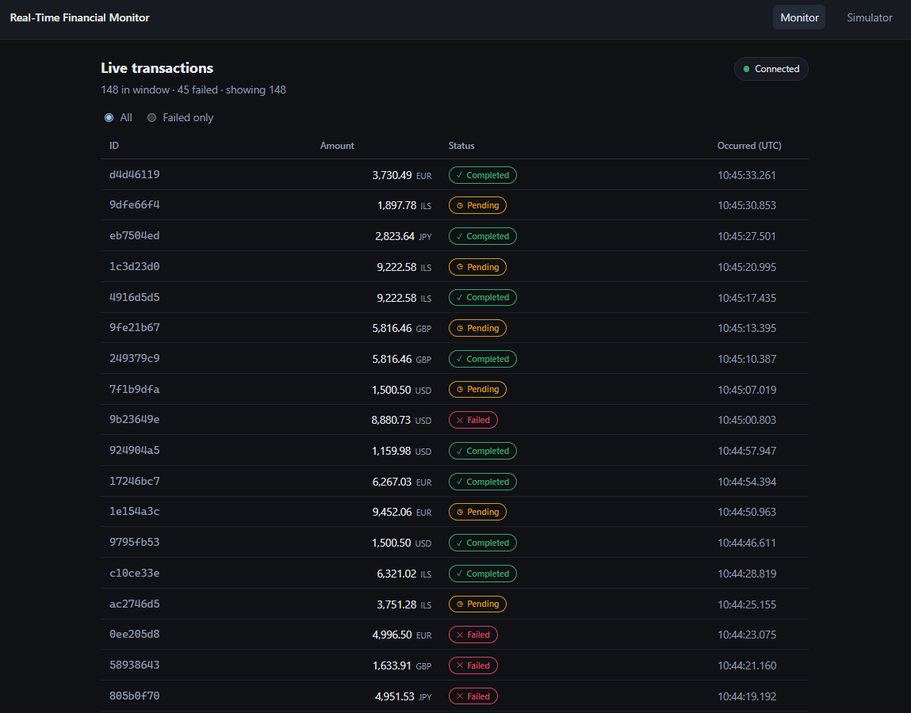
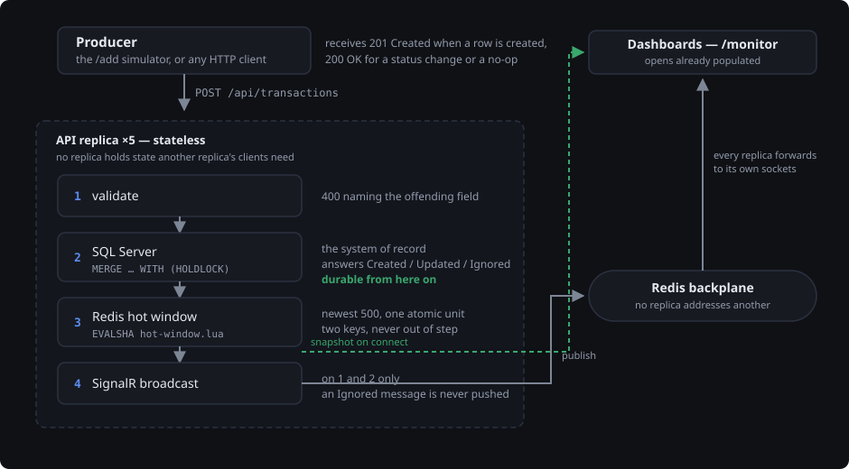

<div align="center">

# Real-Time Financial Monitor

**Transactions arrive over HTTP, are validated, persisted, and pushed to a live dashboard — in that order, every time.**

[](https://dotnet.microsoft.com/)
[](https://react.dev/)
[](https://www.typescriptlang.org/)
[](https://www.microsoft.com/sql-server)
[](https://redis.io/)
[](#tests)

</div>



An external system POSTs financial transactions. The service validates them,
writes them to SQL Server, projects them into a Redis hot window, and pushes them
over SignalR to every connected dashboard. The dashboard opens already populated,
updates instantly, and stays responsive under bursts.

It runs as **five stateless replicas**: no replica holds state that another
replica's clients need, so the replica count is an operational choice rather than
an application concern.

---

## Run it

Two terminals, both left running. No Docker, no database, no Redis — storage is
in-process and everything else is real.

```bash
dotnet run --project src/Rtfm.Api
```

```bash
cd client && npm install && npm run dev
```

Open **<http://localhost:5173/monitor>**, and the simulator in a second tab at
**<http://localhost:5173/add>**.

| Try this | What it shows |
|---|---|
| **Send 100 rapid** | A burst of 100 arrives as one render, not a hundred. The page stays interactive throughout. |
| **Send lifecycle** | The same `transactionId` sent twice — the row transitions in place instead of a second row appearing. |
| Open `/monitor` in a third tab | It opens already populated, straight from the hot window. |
| Stop the first terminal | The connection indicator goes amber, then green again when you restart it. |

**The full topology**, with SQL Server and Redis in containers:

```bash
docker compose up --build
```

**Kubernetes** — five replicas, resource limits, and two probes that ask
different questions:

```bash
kubectl apply -f k8s/
```

---

## How a transaction flows



The order is a correctness decision, not a performance detail. A transaction is
never pushed to an agent's screen unless it is already durable — an agent acting
on a transaction that does not survive a restart is a correctness failure, not a
latency trade-off.

A repeated `transactionId` is a **status change, not a duplicate to reject**.
`Pending → Completed` and `Pending → Failed` update the row; everything else is
ignored and is never broadcast.

---

## What each technology is responsible for

| Technology | Owns | Why this, and not the alternative |
|---|---|---|
| **ASP.NET Core Minimal APIs** | Translating HTTP into a domain call and back. Nothing else. | A controller holding business rules is a rule you cannot test without a web host. |
| **`Rtfm.Core`** | Validation, the lifecycle rule, the ingestion order. | **Zero package references** — not even `Microsoft.Extensions.*`. If a package appears here, the dependency direction has been violated and the build makes that obvious. |
| **SQL Server + Dapper** | The system of record, *and* the enforcement of identity and concurrency. | Dapper over EF Core because the data access is a handful of deliberate statements, one of which is a `MERGE` whose exact shape **is** the concurrency guarantee. An ORM would hide the statement that matters most. |
| **Redis — sorted set + hash** | The hot window: the newest 500 transactions, serving every dashboard snapshot. | A sorted set because `ZADD` on an existing member updates its score **in place**, so a status change cannot produce a second entry. A list would append a duplicate. |
| **Redis — one Lua script** | Maintaining both keys atomically on every write. | The trim is read-then-act: the ids to delete come from the `ZRANGE`. `MULTI`/`EXEC` cannot consume a reply inside the transaction that queued it, so across five replicas payloads end up orphaned from the index. |
| **Redis pub/sub (SignalR backplane)** | Fan-out. Each replica publishes; every replica forwards to its own local sockets. | No replica addresses another — which is exactly what makes the replica count irrelevant. |
| **SignalR over WebSockets** | The push channel and reconnection. | Hand-rolling reconnect, backpressure and fan-out means rebuilding what SignalR has, then building the backplane on Redis pub/sub anyway. |
| **React 18 + TypeScript** | Rendering state it is given. It holds no truth of its own. | State is a `Map` keyed on `transactionId`, so a duplicate overwrites itself — which is why the server needs no deduplication at all. |
| **Polly** | Retry with exponential backoff and jitter on transient SQL and Redis faults. | Jitter matters at five replicas: without it, one dependency hiccup produces five synchronised retry waves at the same instants. |

---

## Tests

```bash
dotnet test
```

**67 passing**, a few seconds, with no Docker, no Redis and no database.

Covers validation, the lifecycle, the broadcast rule, and the full
`ITransactionStore` contract — including several hundred parallel upserts of the
**same** id (exactly one applies, row count 1), window bounding by `OccurredAt`
with insert order deliberately shuffled, and reads issued in a loop during
sustained writes.

A separate Testcontainers suite covers what only real infrastructure can show —
Lua atomicity under parallel clients, rebuild-on-miss after a Redis flush. It is
opt-in, so a machine with no Docker still gets a green run:

```bash
$env:RTFM_INTEGRATION = "1"; dotnet test tests/Rtfm.IntegrationTests
```

---

## Known limitations

Scoped out deliberately. Each is listed with what would trigger building it.

| Limitation | Next step |
|---|---|
| **Redis is a single point of failure** for both state and transport. If it is down, real-time delivery stops and snapshots fall back to SQL Server. Persisted transactions are never lost. | Sentinel or managed clustered Redis; splitting the backplane from the cache if their availability needs diverge. |
| **The backplane broadcasts every message to every replica.** | At tens of replicas, partition with SignalR Groups keyed on agent scope. |
| **Broadcast is at-most-once.** A failed broadcast is logged and dropped; the dashboard repairs its view from the next reconnect snapshot. | A durable per-client cursor — not a more reliable broadcast. |
| **No authentication or authorization.** Every endpoint and the hub are open. | The first thing to add before any deployment outside a private network. |
| **No rate limiting.** | ASP.NET Core's rate limiter, per producer identity — which needs the auth above first. |
| **`Currency` is stored but never used.** Validated for format, persisted, displayed. No conversion or aggregation. | Multi-currency totals need a rate source and a policy on which rate applies when. |
| **No row virtualization.** The dashboard renders a bounded 200 rows, which is what keeps it fast. | Virtualization once an agent can scroll through thousands. |
| **No transport fallback.** The client skips negotiation and connects over WebSockets only, which removes the need for sticky sessions. | Enabling negotiation — which then requires sticky sessions at the ingress. |

Also deliberately absent: event sourcing, CQRS, ingestion queues, Kafka, Helm
charts, CI pipelines.

---

## Going deeper

| | |
|---|---|
| [**`docs/adr/README.md`**](docs/adr/README.md) | Eight architecture decision records — the context, the decision, every alternative rejected and why, and the costs. |
| [**`NOTES.md`**](NOTES.md) | Nine smaller implementation decisions, including one objection. |

```
src/Rtfm.Core/            domain model, validation, ITransactionStore, IBroadcaster
src/Rtfm.Infrastructure/  SQL + Redis store, in-memory store, the Lua script
src/Rtfm.Api/             endpoints, TransactionsHub, DI wiring, health checks
tests/Rtfm.Tests/         unit and contract tests — no infrastructure
client/                   React 18 + TypeScript, strict, no `any`
db/schema.sql · k8s/ · Dockerfile · docker-compose.yml
```
